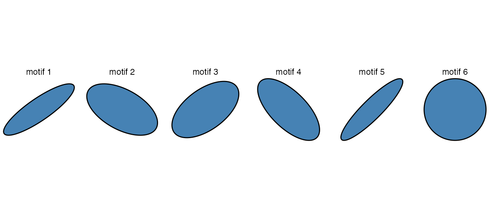
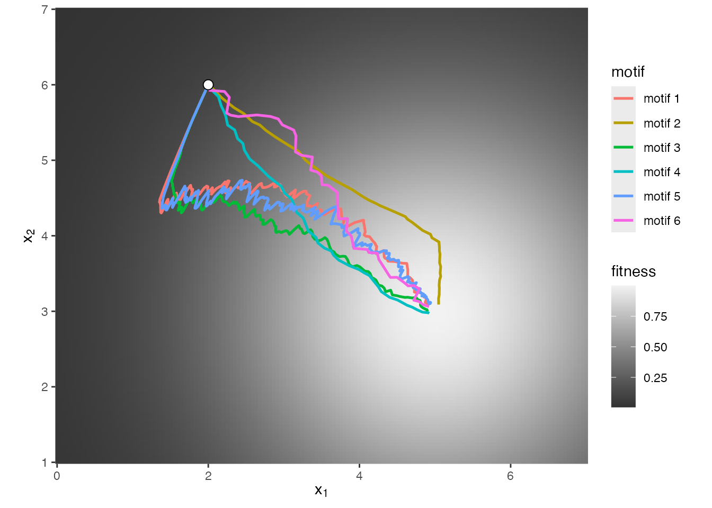

# Getting started with grnland

grnland simulates populations whose phenotypes are the steady states of
gene regulatory networks (GRNs). Genotypes are network parameters,
development solves the network dynamics, and selection acts on the
resulting phenotypes on an adaptive landscape of your choice. Because
the genotype-phenotype map is a dynamical system, the variation that
mutation produces (the M-matrix) depends on the network and changes as
the population evolves.

The workflow has four steps: define a **model**, map **genotypes to
phenotypes**, define a **landscape**, and **simulate** a population on
it.

``` r

library(grnland)
```

## 1. Define a network

Networks are written as edges: `"a -> b"` means *a activates b*,
`"a -| b"` means *a represses b*. Each gene follows Hill-type kinetics,

\\\dot x_i = \alpha_i \prod_j H\_{ij}(x_j) - \gamma_i x_i,\\

with production rate \\\alpha_i\\, decay rate \\\gamma_i\\, and
\\H\_{ij}(x) = x^h/(\theta^h + x^h)\\ for activation, \\1 -
x^h/(\theta^h + x^h)\\ for repression.

``` r

m <- grn(c("a -> b", "b -| c", "c -> a", "a -| c"),
         alpha = c(4, 6, 8), theta = 3,
         evolvable = c("alpha", "theta"),  # parameters that mutate
         traits = c("b", "c"))             # genes under selection
m
#> <hill_grn> 3 genes, 7 loci, traits: b, c
#> edges: a -> b, a -| c, b -| c, c -> a 
#> loci: alpha[a], alpha[b], alpha[c], theta[a,c], theta[b,a], theta[c,a], theta[c,b]
```

Any parameter can be a locus: whole classes (`"alpha"`, `"gamma"`,
`"theta"`, `"hill"`) or single entries (`"alpha[b]"`, `"theta[c,a]"`).
Genes not listed in `traits` still develop and regulate, but are
invisible to selection.

The six two-gene motifs of the paper are built in:

``` r

paper_motif(3)   # x1 -> x2, x2 -| x1
#> <hill_grn> 2 genes, 2 loci, traits: x1, x2
#> edges: x1 -> x2, x2 -| x1 
#> loci: alpha[x1], alpha[x2]
```

## 2. Genotype to phenotype

``` r

g <- default_genotype(m)
g
#> [1] 4 6 8 3 3 3 3
phenotype(m, g)          # steady state of the trait genes
#>        b        c 
#> 2.335530 2.747221
develop(m, g)$status     # 0 = converged to a stable steady state
#> [1] 0
```

[`genotype_at()`](https://diogro.github.io/grnland/reference/genotype_at.md)
goes the other way, finding a genotype that develops into a target
phenotype:

``` r

mot <- paper_motif(5)
g5 <- genotype_at(mot, c(2, 6))
phenotype(mot, g5)
#> x1 x2 
#>  2  6
```

### Sensitivities and the M-matrix

The sensitivity matrix \\S = \partial x^\*/\partial p\\ is computed
analytically from the Jacobian of the dynamics (\\S = -J^{-1}\\\partial
f/\partial p\\). With per-locus mutation rate \\\mu\\ and mutational
effect \\\sigma\\, the M-matrix is \\M = S\\\Sigma\\S^\top\\ with
\\\Sigma = \mu\sigma^2 I\\ (times the ploidy).

``` r

m_matrix(mot, phenotype = c(2, 6), mu = 0.01, sigma = 0.05)
#>              x1           x2
#> x1 1.641190e-05 3.562623e-05
#> x2 3.562623e-05 7.936391e-05
```

The same phenotype has a differently shaped M under each motif. Here are
the six paper motifs at one phenotype, each scaled to unit trace:

``` r

library(ggplot2)
ellipse <- function(M, n = 100) {
  e <- eigen(M / sum(diag(M)), symmetric = TRUE)
  t <- seq(0, 2 * pi, length.out = n)
  pts <- cbind(cos(t), sin(t)) %*% diag(sqrt(pmax(e$values, 0))) %*% t(e$vectors)
  data.frame(x = pts[, 1], y = pts[, 2])
}
shapes <- do.call(rbind, lapply(1:6, function(k)
  cbind(ellipse(m_matrix(paper_motif(k), phenotype = c(3, 3))), motif = paste("motif", k))))
ggplot(shapes, aes(x, y)) + geom_polygon(fill = "steelblue", colour = "black") +
  facet_wrap(~motif, nrow = 1) + coord_equal() + theme_void()
```



## 3. Landscapes

A landscape is any function from a phenotype matrix (one row per
individual) to fitness values. Constructors cover the common cases:

``` r

single <- landscape_gaussian(c(5, 3), omega = 4)              # one Gaussian peak
rugged <- landscape_perlin(frequency = 0.3, seed = 6)         # Perlin noise
twin   <- landscape_smoothmax(landscape_gaussian(c(4, 4), 2),
                              landscape_gaussian(c(7, 7), 2)) # smooth maximum
find_peaks(rugged, lower = 0, upper = 10)
#>         x1       x2   fitness
#> 1 9.498998 1.543086 0.7741733
#> 2 5.951904 2.044088 0.7024886
#> 3 1.783567 2.525050 0.7891941
#> 4 9.158317 6.873747 0.5752231
#> 5 4.929860 7.474950 0.8306507
#> 6 1.903808 8.977956 0.8157665
```

[`landscape_grid()`](https://diogro.github.io/grnland/reference/landscapes.md)
caches a slow landscape on a grid and interpolates bilinearly, which
speeds up Perlin landscapes about three-fold in simulations.

## 4. Simulate

``` r

land <- landscape_gaussian(c(5, 3), omega = 4)
sim <- simulate_population(paper_motif(1), land, start = c(2, 6),
                           N = 500, generations = 3000, mu = 0.01, sigma = 0.05,
                           stop = stop_at_peaks(matrix(c(5, 3), 1)),
                           record_every = 20, seed = 1)
sim
#> <grn_sim> 1930 generations, N = 500, clonal, ploidy 1
#> final mean phenotype: x1 = 4.917, x2 = 3.097 
#> outcome (peak reached): 1
head(sim$trajectory)
#>   generation  mean_x1  mean_x2      P_x1_x1      P_x1_x2     P_x2_x2
#> 1          0 2.000000 6.000000 0.0000000000 0.0000000000 0.000000000
#> 2         20 1.895706 5.772462 0.0012175551 0.0026894564 0.005946854
#> 3         40 1.717282 5.365507 0.0007538154 0.0017142964 0.003989614
#> 4         60 1.503385 4.854077 0.0006401127 0.0015872279 0.003951387
#> 5         80 1.359507 4.480000 0.0005941564 0.0015438651 0.004086775
#> 6        100 1.355875 4.442836 0.0001850443 0.0004656127 0.001187334
#>   mean_fitness n_invalid
#> 1    0.1053992         0
#> 2    0.1146418         0
#> 3    0.1291280         0
#> 4    0.1410643         0
#> 5    0.1449996         0
#> 6    0.1465559         0
```

The trajectory records the mean phenotype, the phenotypic covariance
matrix (`P_*`), mean fitness and the number of individuals whose
development failed. Set `record_m = TRUE` to also record the M-matrix at
the mean genotype.

Options include:

- `ploidy = 2, reproduction = "sexual"` for diploid sexual populations
  with free recombination (`sexes = TRUE` for separate sexes);
- `selection = selection_proportional()` or `selection_exponential(s)`
  instead of the default of the original scripts (`w - min(w) + 0.001`);
- `invalid = "reject"` to resample offspring whose development fails
  instead of treating them as lethal;
- `stop = stop_at_peaks(peaks)` to stop when the population sits on a
  peak.

### Different networks, different paths

Even on a single symmetric peak, the network shapes the path. All six
motifs start from the same phenotype and climb the same peak:

``` r

paths <- do.call(rbind, lapply(1:6, function(k) {
  s <- simulate_population(paper_motif(k), land, start = c(2, 6), N = 500,
                           generations = 3000, record_every = 10, seed = k,
                           stop = stop_at_peaks(matrix(c(5, 3), 1)))
  cbind(s$trajectory[, c("generation", "mean_x1", "mean_x2")], motif = paste("motif", k))
}))
bg <- expand.grid(x1 = seq(0, 7, length.out = 150), x2 = seq(1, 7, length.out = 150))
bg$w <- land(as.matrix(bg))
ggplot(bg, aes(x1, x2)) + geom_raster(aes(fill = w)) +
  scale_fill_gradient(low = "grey20", high = "grey95", name = "fitness") +
  geom_path(data = paths, aes(mean_x1, mean_x2, colour = motif), linewidth = 0.9) +
  annotate("point", 2, 6, shape = 21, size = 3, fill = "white") +
  coord_equal(expand = FALSE) + labs(x = expression(x[1]), y = expression(x[2]))
```



Motifs whose M has positive covariance between the traits (1, 3, 5)
first move down and to the left, along the long axis of their M, where
fitness rises fastest for the variation they have, and only then turn
towards the peak. Motifs with negative covariance (2, 4) head right, and
the unregulated motif 6 takes the most direct route. On rugged
landscapes such differences can decide *which* peak is reached: see the
article *Paper figures and examples*.

## Beyond Hill networks

**Custom dynamics.**
[`grn_custom()`](https://diogro.github.io/grnland/reference/grn_custom.md)
takes any ODE right-hand side, for regulatory logic the Hill model
cannot express (additive inputs, basal expression). It runs in R and is
slower.

``` r

cm <- grn_custom(
  function(x, p) c(p[["a1"]] - x[1],
                   p[["a2"]] * (0.2 + x[1] / (5 + x[1])) - x[2]),
  params = c(a1 = 2, a2 = 2), genes = c("x1", "x2"))
phenotype(cm, default_genotype(cm))
#>        x1        x2 
#> 2.0000000 0.9714286
```

**Linear maps.** `gp_linear(B)` gives the linear genotype-phenotype map
\\x = B\alpha\\, with a constant M-matrix, a useful null model:

``` r

lin <- gp_linear(matrix(c(5, 4, 4, 5) / 3, 2))
m_matrix(lin, phenotype = c(1, 1))
#>              x1           x2
#> x1 0.0001138889 0.0001111111
#> x2 0.0001111111 0.0001138889
```

**Basins under the Lande equation.**
[`lande_separatrices()`](https://diogro.github.io/grnland/reference/lande_separatrices.md)
traces basin borders for deterministic evolution \\\dot{\bar z} =
G\\\nabla W\\ with \\G \propto M\\, which can be compared with simulated
outcomes.

**More traits.** Nothing is specific to two traits: networks can have
any number of genes, and `traits` chooses which are selected. Landscapes
in more dimensions can be Gaussian, Perlin (3D) or any function.
