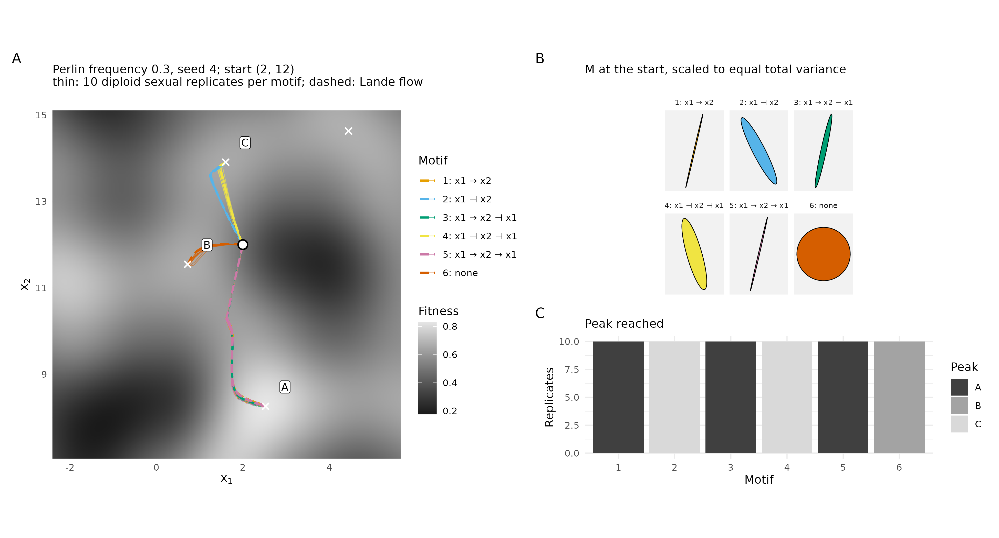
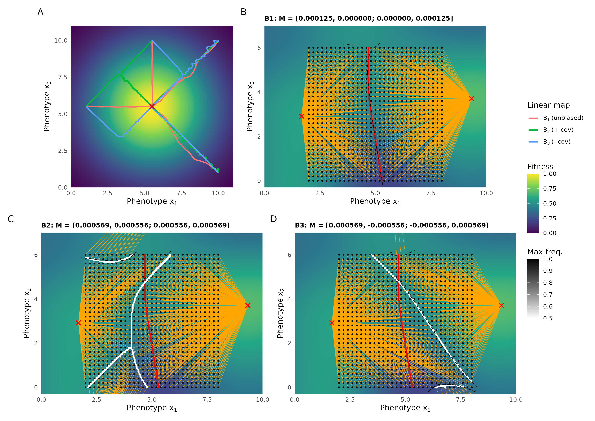
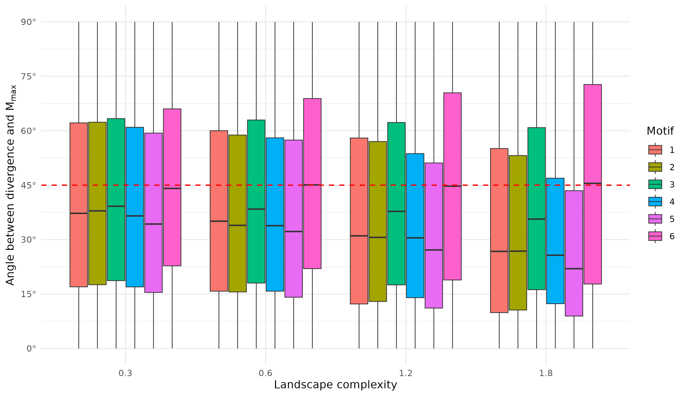
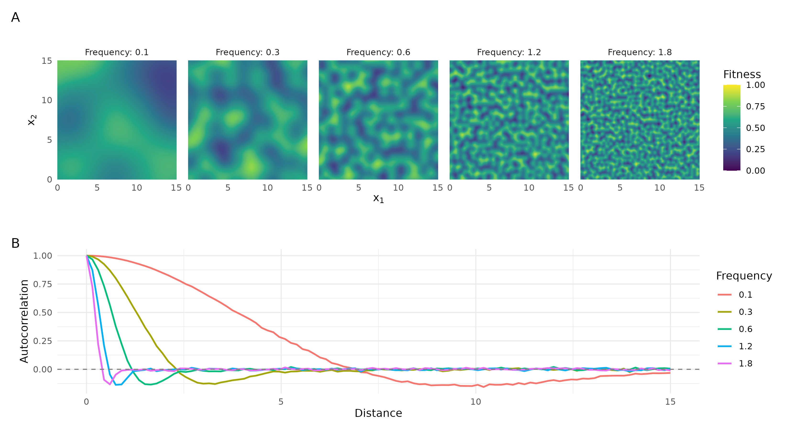

# Paper figures and examples

This article walks through the figures of *Developmental Bias Shapes
Evolution on Complex Adaptive Landscapes* (Netz, Melo & Milocco) and
shows how each is built with `grnland`. The complete pure R scripts
reproducing all manuscript figures are in the
[`GRN_Landscapes`](https://github.com/diogro/GRN_Landscapes) repository;
the code below shows the essential calls.

All figures come from full diploid sexual simulations matching the
manuscript:

``` r

library(grnland)
PAPER <- list(
  N = 1000L, generations = 10000L, mu = 0.025, sigma = 0.05,
  ploidy = 2L, reproduction = "sexual", sexes = TRUE,
  selection = selection_relative_min(0.001)
)
```

Simulations stop once the population mean phenotype stays within
Euclidean distance \\0.1\\ of the same local optimum for two consecutive
10-generation checkpoints (up to the generation cap). A companion script
(`trial_selection.R`) verifies that standard Wright–Fisher proportional
selection
([`selection_proportional()`](https://diogro.github.io/grnland/reference/selection.md))
yields virtually identical basins (98.2%–98.6% outcome agreement on the
complex landscape) and complexity/alignment curves.

## The six motifs

Every figure compares the same six two-gene networks. Each gene has its
own production rate \\\alpha_i\\ as the evolving additive diploid locus
(\\\alpha_i = \alpha\_{i,1} + \alpha\_{i,2}\\); the motifs differ only
in how the two genes regulate each other (\\\gamma = 1\\, \\\theta =
5\\).

| Motif | Regulation | [`paper_motif()`](https://diogro.github.io/grnland/reference/paper_motif.md) |
|----|----|----|
| 1 | \\x_1 \to x_2\\ | `paper_motif(1)` |
| 2 | \\x_1 \dashv x_2\\ | `paper_motif(2)` |
| 3 | \\x_1 \to x_2\\, \\x_2 \dashv x_1\\ | `paper_motif(3)` |
| 4 | mutual repression | `paper_motif(4)` |
| 5 | mutual activation | `paper_motif(5)` |
| 6 | no regulation | `paper_motif(6)` |

## Motifs reach different peaks

*Script: `motif_example.R`.* Before the paper figures, a single-picture
example of the main idea. All six motifs start from the same phenotype
`(2, 12)` on the same rugged landscape (Perlin frequency `0.3`, seed
`4`). Because their M-matrices point in different directions (panel B),
they climb to three different peaks (panels A and C), and all 10 diploid
sexual replicates per motif reach the peak predicted by the
deterministic Lande flow \\\dot{\bar z} = M\nabla W\\.



Motifs with positive covariance between the traits (1, 3, 5) go to peak
A, those with negative covariance (2, 4) to peak C, and the unregulated
motif 6, with an isotropic M-matrix, to peak B.

``` r

land <- landscape_perlin(frequency = 0.3, seed = 4)
peaks <- find_peaks(land, 0, 20, res = 500)
runs <- lapply(1:6, function(k)
  simulate_population(paper_motif(k), landscape_grid(land, 0, 20), start = c(2, 12),
                      N = 1000, generations = 10000, mu = 0.025, sigma = 0.05,
                      ploidy = 2, reproduction = "sexual", sexes = TRUE,
                      record_every = 20, seed = k))
```

## Fig 1: linear genotype-phenotype maps

*Script: `fig1_linear_maps.R`.* With a linear map \\x = B\alpha\\ the
diploid M-matrix is constant, \\M = 2\mu\sigma^2 BB^\top\\. Three
equal-determinant maps (no covariance, positive, negative; unbounded
alleles) evolve on a single Gaussian peak (A) and on a two-peak Perlin
landscape (B–D; frequency `0.15`, seed `96`, offset `(0, -2.5)`, \\31
\times 31\\ grid, 10 replicates per start). Outcomes are classified by
an SVM (red border for \\\mathbf{B}\_1\\, white borders for
\\\mathbf{B}\_2, \mathbf{B}\_3\\; 10-fold CV accuracies 99.6%, 99.0%,
99.1%) and compared with the deterministic Lande separatrix (dashed
black).

``` r

B <- list(B1 = diag(2),
          B2 = matrix(c(5, 4, 4, 5) / 3, 2),
          B3 = matrix(c(5, -4, -4, 5) / 3, 2))
models <- lapply(B, gp_linear)
land <- landscape_perlin(frequency = 0.15, seed = 96, offset = c(0, -2.5))
lande <- lande_separatrices(models$B2, land, lower = -2, upper = 12)
```



## Fig 2: M-matrices across phenotype space

*Script: `fig2_m_matrices.R`.* Diploid M-matrices (\\M = 2\mu\sigma^2 S
S^\top\\, \\\mu = 0.025, \sigma = 0.05\\, 95% confidence ellipses
magnified 26×) and sensitivity vectors \\\partial x/\partial\alpha_i\\
(blue for \\\alpha_1\\, red for \\\alpha_2\\) over a \\5 \times 5\\ grid
in \\\[2, 10\]^2\\, with pure-R motif topology diagrams.

``` r

grid <- expand.grid(x1 = seq(2, 10, length.out = 5), x2 = seq(2, 10, length.out = 5))
Ms <- lapply(seq_len(nrow(grid)), function(i)
  m_matrix(paper_motif(3), phenotype = unlist(grid[i, ]),
           mu = 0.025, sigma = 0.05, ploidy = 2))
S <- sensitivity(paper_motif(3), genotype_at(paper_motif(3), c(4, 4)))
```


## Fig 3, S1, S2: basins of attraction

*Script: `fig3_basins.R`.* Diploid sexual populations start from a \\41
\times 41\\ grid of phenotypes in \\\[2, 10\]^2\\ (10 replicates each;
201,720 runs total) on a simple (frequency `0.1`, seed `1234`) and a
complex (frequency `0.5`, seed `1245`) Perlin landscape. SVM basin
borders (white; motif 6 reference in red; 10-fold CV accuracies
98.3%–99.5% simple, 97.3%–97.9% complex) closely match the
Lande-equation separatrices (black in Figs. S1 and S2).

``` r

simple <- landscape_perlin(frequency = 0.1, seed = 1234)
land <- landscape_grid(simple, -5, 25, step = 0.02)
peaks <- find_peaks(simple, -5, 25, res = 800)
sim <- simulate_population(paper_motif(1), land, start = c(4, 6),
                           N = 1000, generations = 10000, mu = 0.025, sigma = 0.05,
                           ploidy = 2, reproduction = "sexual", sexes = TRUE, seed = 1)
```


Fig 3, complex landscape (Motifs 1 and 2 vs. Motif 6 in red)


Fig S1: simple landscape, all six motifs, with Lande separatrices
(black)

## Fig 4 and 5: landscape complexity

*Script: `fig4_fig5_complexity.R`.* Twenty random Perlin landscapes per
frequency (`0.3, 0.6, 1.2, 1.8`, offset `0.5`), \\25 \times 25\\
starting grid in \\\[2, 10\]^2\\, mutational SD \\\sigma = 0.2\\ (plus a
\\\sigma = 0.05\\ check across 10 landscapes and a \\21 \times 21\\
grid). Fig. 4A shows mean outcome mismatch against the unregulated motif
6 (rising from 0.09–0.14 at frequency 0.3 to 0.29–0.38 at frequency
1.8); Fig. 4B shows pairwise outcome agreement between all six motifs.


Fig. 5 measures the angle between each population’s divergence vector
(from its starting phenotype to the local optimum it reaches) and the
dominant eigenvector \\M\_{\max}\\ of the M-matrix at that optimum. For
the isotropic motif 6, the numerical eigenvector is arbitrary and angles
stay uniform around 45°; for all five regulated motifs, angles decrease
monotonically with landscape complexity (down to medians of 22.0°–35.7°
at frequency 1.8).



## Fig 6: trajectories of G and M

*Script: `fig6_trajectories.R` (candidate found via `fig6_search.R`).*
Motifs 1 and 5 start at `(1.0, 4.0)`—where their local diploid
M-matrices share nearly identical eccentricity (0.99991 vs. 0.99986) and
orientation (73.34° vs. 73.40°)—on a twin-peak landscape built as the
smooth maximum (\\\beta = 100\\) of two shifted, squared
frequency-`0.05` Perlin layers (seed `44`). Across 10 diploid sexual
replicates (\\N = 10{,}000\\, 6,000 generations), 9/10 motif 1
replicates reach `(8.45, 9.05)` while 10/10 motif 5 replicates reach
`(7.61, 8.21)`. The additive genetic covariance matrix \\\mathbf{G}\\ is
estimated every 50 generations by mid-parent–offspring regression (5,000
random pairs independent of fitness).

``` r

layer <- function(offset) {
  landscape_perlin(frequency = 0.05, seed = 44, offset = offset,
                   transform = function(z) ((z + 1) / 2)^2)
}
twin <- landscape_smoothmax(layer(c(0, 1)), layer(c(-1, 0)), beta = 100)
```


## Fig S3: Perlin landscapes

*Script: `figS3_perlin.R`.* Perlin adaptive landscapes at five
increasing frequencies (`0.1, 0.3, 0.6, 1.2, 1.8`; seed `1234`, offset
`0.5`) and their spatial autocorrelation profiles.



## Running the scripts

From the `GRN_Landscapes` repository root:

``` sh
QUICK=1 OPENBLAS_NUM_THREADS=1 Rscript fig3_basins.R   # quick pipeline check
OPENBLAS_NUM_THREADS=1 OMP_NUM_THREADS=1 MKL_NUM_THREADS=1 Rscript run_all.R
```

Results are cached in `output/`, so re-running a script only redraws its
figure; set `REDO=1` to recompute, `SIGMA=0.05` for the low-mutation
Fig. 4–5 check, or `SELECTION=proportional` for proportional
Wright–Fisher selection.
