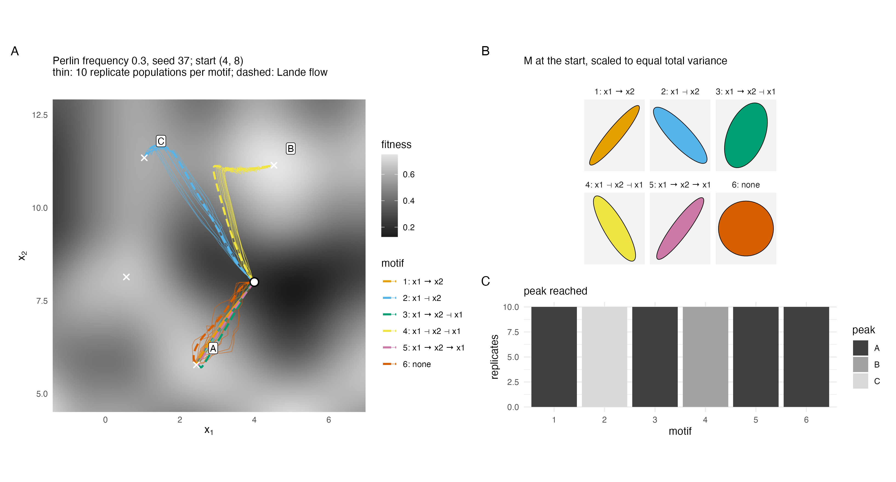
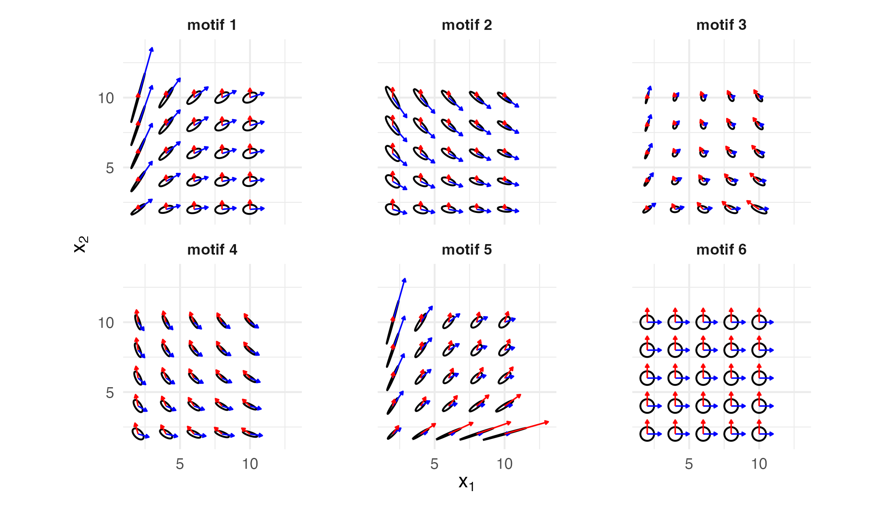
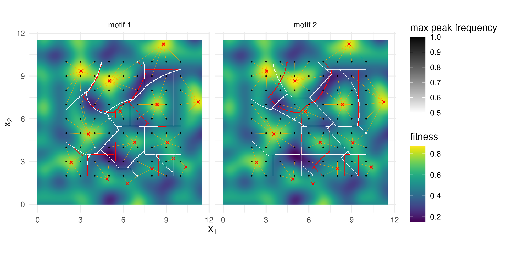
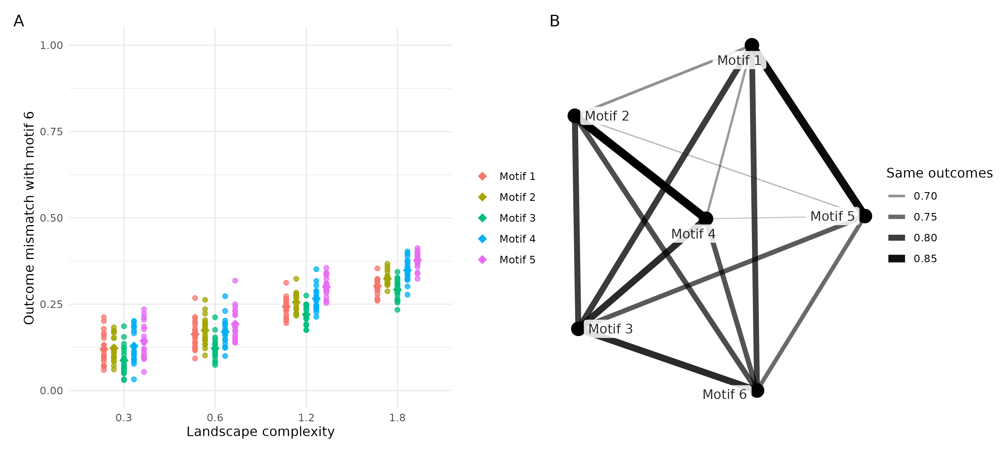
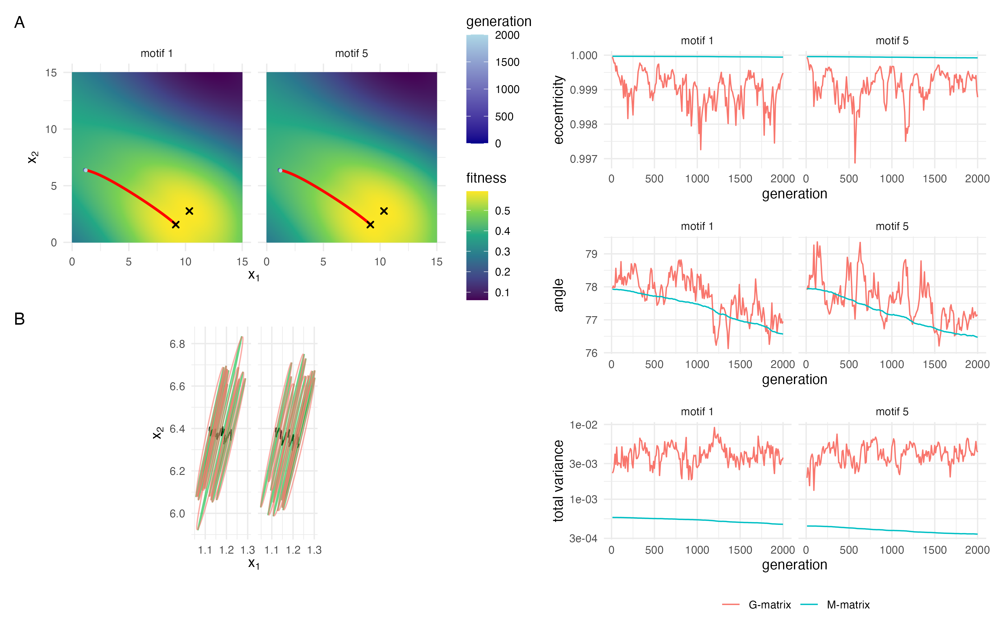

# Paper figures and examples

This article walks through the figures of *Developmental Bias Shapes
Evolution on Complex Adaptive Landscapes* (Netz, Melo & Milocco) and
shows how each is built with grnland. The complete scripts are in the
[`analysis/`](https://github.com/diogro/grnland/tree/main/analysis)
folder of the repository; the code below shows the essential calls.

> **About the images.** The full figure runs take many core-hours (about
> 200,000 simulations for Fig 3 and 500,000 for Fig 4), so the figures
> shown here, except the motif example, come from the reduced pipeline
> check (`QUICK=1`: coarse grids and few replicates). They show what
> each figure contains, not final results.

All scripts share the simulation settings of the original analysis code:

``` r

library(grnland)
PAPER <- list(N = 1000, generations = 10000, mu = 0.01, sigma = 0.05,
              ploidy = 1, reproduction = "clonal")
```

## The six motifs

Every figure compares the same six two-gene networks. Each gene has its
own production rate \\\alpha_i\\ as the evolving locus; the motifs
differ only in how the two genes regulate each other.

| Motif | Regulation | [`paper_motif()`](https://diogro.github.io/grnland/reference/paper_motif.md) |
|----|----|----|
| 1 | \\x_1 \to x_2\\ | `paper_motif(1)` |
| 2 | \\x_1 \dashv x_2\\ | `paper_motif(2)` |
| 3 | \\x_1 \to x_2\\, \\x_2 \dashv x_1\\ | `paper_motif(3)` |
| 4 | mutual repression | `paper_motif(4)` |
| 5 | mutual activation | `paper_motif(5)` |
| 6 | no regulation | `paper_motif(6)` |

## Motifs reach different peaks

*Script: `analysis/motif_example.R`.* Before the paper figures, an
example that shows the main idea in one picture. All six motifs start
from the same phenotype on the same rugged landscape. Because their
M-matrices point in different directions (panel B), they climb to
different peaks (panels A and C), and every one of 10 replicate
populations per motif ends on the peak predicted by the deterministic
Lande equation \\\dot{\bar z} = M\nabla W\\.


Motifs whose M has positive covariance between the traits (1, 3, 5) go
to peak C, those with negative covariance (2, 4) to peak A, and the
unregulated motif 6, with a round M, to peak B.

The example was found by a screen: for 120 Perlin landscapes and a grid
of starting points, integrate the Lande flow of each motif and keep
starts where the motifs reach at least three peaks, robustly to small
shifts of the start; then check the best candidates with stochastic
simulations.

``` r

land <- landscape_perlin(frequency = 0.4, seed = 6)
peaks <- find_peaks(land, 0, 20, res = 500)
runs <- lapply(1:6, function(k)
  simulate_population(paper_motif(k), landscape_grid(land, 0, 20), start = c(4, 8),
                      N = 1000, generations = 10000, mu = 0.01, sigma = 0.05,
                      stop = stop_at_peaks(peaks), record_every = 20, seed = k))
sapply(runs, `[[`, "outcome")   # index of the peak each motif reached
```

Another landscape from the same screen, where four motifs share one peak
and motifs 2 and 4 each reach a different one:



## Fig 1: linear genotype-phenotype maps

*Script: `analysis/fig1_linear_maps.R`.* With a linear map \\x =
B\alpha\\ the M-matrix is constant, \\M = \mu\sigma^2 BB^\top\\. Three
maps (no covariance, positive, negative) evolve on a single peak (A) and
on a two-peak landscape (B), where outcomes from a grid of starts are
classified by an SVM (white borders) and compared with the separatrix of
the Lande equation (dashed).

``` r

B <- list(B1 = diag(2),
          B2 = matrix(c(5, 4, 4, 5) / 3, 2),
          B3 = matrix(c(5, -4, -4, 5) / 3, 2))
models <- lapply(B, gp_linear)
land <- landscape_perlin(frequency = 0.1, seed = 324)
lande <- lande_separatrices(models$B2, land, lower = -5, upper = 15)
```


## Fig 2: M-matrices across phenotype space

*Script: `analysis/fig2_m_matrices.R`.* M-matrices of each motif over a
grid of phenotypes, with the sensitivity vectors \\\partial
x/\partial\alpha_i\\. Regulation makes M vary in size, shape and
orientation across phenotype space.

``` r

grid <- expand.grid(x1 = seq(1, 10, by = 1.5), x2 = seq(1, 10, by = 1.5))
Ms <- lapply(seq_len(nrow(grid)), function(i)
  m_matrix(paper_motif(3), phenotype = unlist(grid[i, ])))
S <- sensitivity(paper_motif(3), genotype_at(paper_motif(3), c(4, 4)))
```



## Fig 3, S1, S2: basins of attraction

*Script: `analysis/fig3_basins.R`.* Populations start from a 41 × 41
grid of phenotypes (10 replicates each) on a simple and a complex Perlin
landscape; lines join each start to the peak reached. SVM borders
between basins differ between motifs (Fig 3 compares motifs 1 and 2 with
the unregulated motif 6 in red), and the Lande-equation separatrices
predict them (Figs S1, S2).

``` r

simple <- landscape_perlin(frequency = 0.1, seed = 1234)
land <- landscape_grid(simple, 0, 15)
peaks <- find_peaks(simple, 0, 15, res = 500)
sim <- simulate_population(paper_motif(1), land, start = c(4, 6),
                           N = 1000, generations = 10000, mu = 0.01, sigma = 0.05,
                           stop = stop_at_peaks(peaks), seed = 1)
sim$outcome
```



Fig 3, complex landscape


Fig S1: simple landscape, all motifs, with Lande separatrices (black)

## Fig 4 and 5: landscape complexity

*Script: `analysis/fig4_fig5_complexity.R`.* Ten Perlin landscapes per
frequency (0.1 to 1.8), mutational sd 0.2. Fig 4A shows how often each
motif reaches a different peak than the unregulated motif 6; Fig 4B the
agreement between all pairs of motifs.



Fig 5 measures the angle between the direction of divergence from motif
6 and the leading eigenvector of M at the peak: angles below 45° mean
divergence follows the direction of most mutational variance.


## Fig 6: trajectories of G and M

*Script: `analysis/fig6_trajectories.R`.* Motifs 1 and 5 start from a
phenotype where their M-matrices are nearly identical, on a landscape of
twin peaks. The figure tracks the mean phenotype, the G-matrix and the
M-matrix (`record_m = TRUE`) through time.

``` r

layer <- function(offset) landscape_perlin(frequency = 0.05, seed = 76, offset = offset,
                                           transform = function(z) ((z + 1) / 2)^2)
twin <- landscape_smoothmax(layer(c(0, 1)), layer(c(-1, 0)), beta = 100)
sim <- simulate_population(paper_motif(5), landscape_grid(twin, 0, 15),
                           start = c(1.12, 6.4), N = 10000, generations = 10000,
                           record_m = TRUE, record_every = 10, seed = 1)
```



With replicates, the outcome from this start is not consistent: the twin
peaks have almost equal heights and are joined by a nearly flat ridge,
so which peak is reached depends largely on drift.
`analysis/fig6_search.R` screens for better starting points; the motif
example above is a robust alternative for showing that motifs diverge.

## Fig S3: Perlin landscapes

*Script: `analysis/figS3_perlin.R`.* Landscapes at increasing Perlin
frequency, and their spatial correlation.


## Running the scripts

``` sh
cd analysis
QUICK=1 OPENBLAS_NUM_THREADS=1 Rscript fig3_basins.R   # quick pipeline check
OPENBLAS_NUM_THREADS=1 N_CORES=32 Rscript fig3_basins.R
```

Results are cached in `analysis/output/`, so a second run only redraws
the figures; set `REDO=1` to recompute. See `analysis/README.md` for
details and run times.
